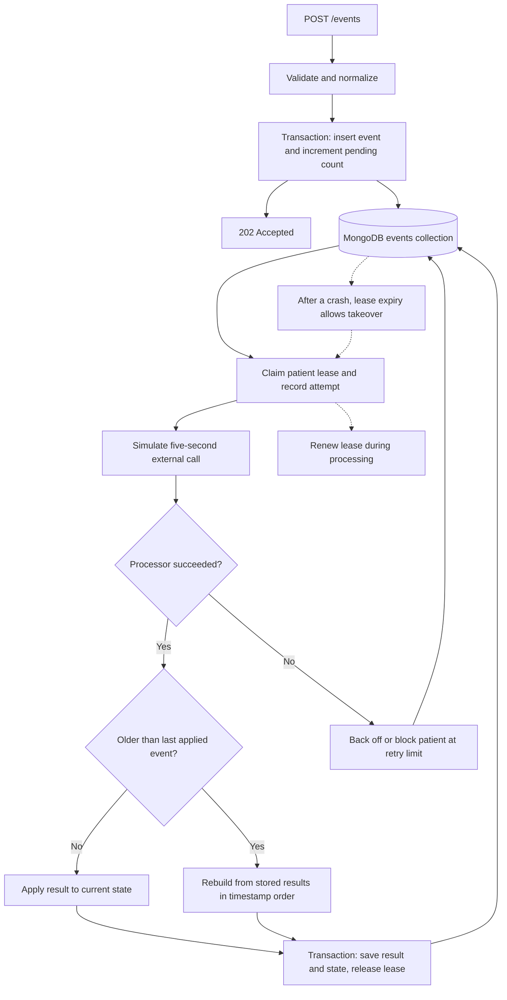

# Ingest service

A NestJS and MongoDB service that accepts patient events over HTTP and processes
them asynchronously, simulating a five-second external call. It coordinates
workers across instances and rebuilds patient state when older events arrive.

## Assumptions

The API adds a required, globally unique `eventId` to the assignment's payload.
Senders must reuse it on retries. This upstream contract still needs confirmation;
a content hash cannot distinguish a retry from two legitimate identical events.

Processor results depend only on their event. Replay reuses stored results.
Processing that depends on prior patient state would need a different strategy.

## Run and verify

Requires Docker with Compose:

```bash
docker compose up --build -d app
docker compose run --build --rm verify
```

This starts the application and a MongoDB replica set, then checks formatting,
lint, types, compilation, unit tests, MongoDB integration tests, and HTTP tests.
Tests use unique databases and leave application data intact.

The API listens at `http://localhost:3000`. Check readiness with:

```bash
curl --fail http://localhost:3000/health/ready
```

MongoDB is available on port 27018. `APP_PORT` and `MONGO_PORT` override host ports.
`docker compose down` retains the database volume.

### Local development

Requires Node 24 or later and pnpm 12.10.1:

```bash
pnpm install --frozen-lockfile
docker compose up -d mongo-init
pnpm start:dev
```

Defaults connect to Compose MongoDB. Copy `.env.example` to `.env` to override
settings; existing environment variables take precedence. Configuration is
validated at startup. Run checks against Compose MongoDB with:

```bash
TEST_MONGODB_URI='mongodb://127.0.0.1:27018/?replicaSet=rs0&directConnection=true' pnpm verify
```

Without `TEST_MONGODB_URI`, database tests start a real MongoDB 7.0.24 replica set
and download its binary on the first run. `MONGOMS_SYSTEM_BINARY` selects an
existing compatible binary.

## API

```bash
curl -i http://localhost:3000/events \
  -H 'Content-Type: application/json' \
  -d '{"eventId":"evt-2","patientId":"patient-1","type":"observation","data":{"value":42},"ts":"2026-01-01T10:02:00Z"}'
```

After the acceptance transaction commits, the service returns `202 Accepted` with
`Location: /events/evt-2`, without waiting for processing:

```json
{ "eventId": "evt-2", "status": "pending", "duplicate": false }
```

Retry a `503` response with the same event ID. Acceptance may have committed even
if its response was lost. An identical retry returns `202`; conflicting reuse of
an ID returns `409`. Invalid input returns `400`, and bodies over 256 KiB return
`413`. A duplicate never adds pending work or retries a failed event.

| Endpoint                      | Purpose                                                                                                                                    |
| ----------------------------- | ------------------------------------------------------------------------------------------------------------------------------------------ |
| `GET /events/:eventId`        | Status, attempt counts, failure code, result, and timestamps. Excludes the clinical payload.                                               |
| `GET /patients/:patientId`    | State, pending count, last ordering key, and status of `current`, `catching_up`, or `blocked`.                                             |
| `POST /events/:eventId/retry` | Requeue a failed event and unblock its patient. Returns `202`; processed events return `409`. Pending or processing events stay unchanged. |
| `GET /health/live`            | Process liveness.                                                                                                                          |
| `GET /health/ready`           | Worker activity and database readiness. Returns `200` when ready, otherwise `503`.                                                         |

Unknown event or patient IDs return `404`.

### Input rules

- IDs are nonempty strings and are preserved exactly. URL-encode them in paths.
- `type` is trimmed and must contain 1 to 128 characters.
- `data` is a JSON object with finite numbers. Unknown top-level fields are rejected.
- `ts` requires an explicit timezone and at most millisecond precision. The service
  normalizes it to UTC and accepts late events without an age cutoff.

Payload keys are preserved by storing `data` as JSON text. MongoDB cannot query
its individual fields. Content fingerprints ignore object-key order but preserve
array order.

To try replay, submit a second event for `patient-1` with a different ID and an
earlier timestamp. After both report `processed`, the patient's state reflects
timestamp order. Reposting either event leaves its applied count unchanged.

## Architecture

MongoDB is both the event store and work queue, avoiding a separate broker and
coordination between database acceptance and queue publication. The native driver
provides conditional writes and transactions; Nest handles HTTP, dependency
injection, and lifecycle hooks.



### Storage and ownership

One `events` collection holds both document kinds:

| Kind    | Identity              | Stored information                                                                       |
| ------- | --------------------- | ---------------------------------------------------------------------------------------- |
| Event   | `event:<eventId>`     | Input, content hash, status, attempt counts, error, result, and timestamps.              |
| Patient | `patient:<patientId>` | State, ordering key, pending count, active and blocked events, next run time, and lease. |

Unique `_id` values prevent duplicates. Partial indexes on
`(patientId, status, ts, eventId)` and `(nextRunAt, lease.until)` support ordered
event selection and patient discovery. Identity records do not expire because
an old retry could otherwise count as new work.

Workers claim patients atomically using MongoDB's clock. Each claim increments
`lease.claimVersion`; every owned write checks the owner, version, and deadline.
An expired worker cannot commit after another takes over. Completion writes the
patient lease inside its transaction so a concurrent takeover causes a write
conflict. A snapshot read alone would not prevent that race.

Processing and replay run outside transactions. Completion commits the event
result and patient state together, decrements pending work, and releases the lease.
Transaction retries repeat database operations only, never external calls.

### Ordering and recovery

The worker resumes interrupted events before selecting the earliest pending event
by timestamp and then event ID in MongoDB's binary string order. The processor returns a fingerprint;
a pure reducer maintains an order-sensitive `{ appliedCount, digest }` state.
For a late event, the store streams completed results in order and rebuilds state
without repeating completed calls.

State includes completed results and remains incomplete while work is pending or
blocked. A late arrival can revise it. Timestamp ties are deterministic, but event
IDs cannot establish clinical causality without an upstream sequence.

Failed attempts retry with exponential backoff and jitter. Abandoned attempts
count toward the limit. Exhaustion blocks only that patient; explicit retry starts
a new cycle and preserves lifetime attempts. After a crash, another worker resumes
once the lease expires. A lost completion response leaves recovery to stored status.

Each event contributes once to committed state. External execution can repeat
after a crash or uncertain outcome, so a real downstream service must deduplicate
by `eventId`. Cancellation is cooperative; adapters must honor abort signals.
Shutdown stops admission and claiming, drains active work, then aborts after the
grace period. Database outages fail admission and trigger dispatcher backoff.

## Capacity and operations

At 1,000 events per minute and five seconds per event, at least 84 concurrent
operations are needed under ideal conditions. The default 128 slots provide a
theoretical ceiling of 1,536 events per minute before overhead. Instances add
capacity across patients; each patient remains limited to roughly 12 events per
minute because processing is serial. Excess work stays in MongoDB.

Defaults in `src/core/config/settings.ts` include a 15-second processing timeout,
a 30-second lease renewed every ten seconds, five attempts per retry cycle, and a
15-second shutdown grace period. Database operations have timeouts.

Local runs enable debug logs; production uses JSON. Logs exclude payloads and
external error messages. Readiness counters reset on restart and can miss a
completion whose response was lost. Use event and patient endpoints for stored
outcomes.

## Tests and load test

Tests cover duplicates, ordering, competing workers, stale ownership, transaction
rollback, retries, timeouts, concurrency limits, process kills, shutdown, and
unavailable storage. Payload preservation and lost completion responses also have
regression tests.

```bash
docker compose run --build --rm load
```

The default load test submits 1,000 new events per minute for ten minutes across
256 patients, duplicating every tenth event and backdating every twentieth. It
checks the offered rate, backlog growth after warm-up, completion latency, and each
patient's chronological digest and unique event count after draining pending work.
It prints JSON results and retains records under unique synthetic IDs.

Set `DURATION_SECONDS`, `EVENTS_PER_MINUTE`, and `PATIENTS` to change the workload.
For a host run, use `pnpm load` and optionally set `BASE_URL`.

## Layout and limitations

- `src/core`: configuration and shared MongoDB connection.
- `src/modules/events`: HTTP, processing, validation, and state logic. Its
  `persistence` directory contains storage and replay; `tests` contains unit tests.
- `test`: MongoDB integration and HTTP tests, including crash recovery.
- `scripts/load.mjs`: sustained workload and independent result checks.

Replay time grows with retained patient history, although cursor batches bound
memory use. Larger histories would need snapshots and archival that preserve
identity and replay behavior. The single-member replica set supports transactions
but cannot survive volume loss; production needs replication, backups, and failover
testing. Retention, metrics, and permanent-error classification need deployment
requirements. Authentication, CI/CD, production infrastructure, and clinical logic
are outside the assignment's scope.
